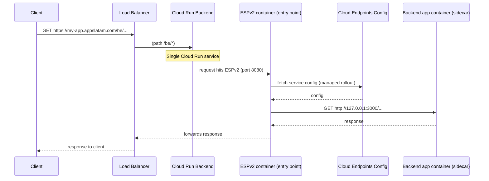

# Backend Network Architecture Overview

A single Cloud Run service named **`{it_element}-{environment}-backend`** handles all Backend API traffic. Its entry point is the **ESPv2** (Envoy) proxy, which fetches the Cloud Endpoints configuration and then proxies requests to the **Backend app** running as a **sidecar container** in the same service (localhost).

The following diagram shows how the communication flows from the client request:

**Explanation of the above flow:**

1. The client sends a request to the Load Balancer (LB) at `https://my-app.appslatam.com/be/*`.
2. The LB forwards the request to the **backend** Cloud Run service (the only Backend-related Cloud Run service).
3. Traffic reaches the **ESPv2 container** (main container, port 8080), which is the service's entry point.
4. ESPv2 fetches the service configuration from Cloud Endpoints (managed rollout).
5. ESPv2 proxies the request to the **Backend app sidecar** at `http://127.0.0.1:3000` inside the same revision.
6. The Backend app processes the request (validates Azure AD token, checks roles, executes business logic, queries the database).
7. The response flows back: Backend app → ESPv2 → LB → client.

## Technical definitions

- **Single Cloud Run service**: One service with two containers:
  - **Main container (ESPv2)**: Receives all traffic on port 8080, fetches Cloud Endpoints config, and proxies to the sidecar.
  - **Sidecar container (Backend app)**: Listens on port 3000; reached by ESPv2 via `http://127.0.0.1:3000`.
- ESPv2 discovers how to route and validate requests from the **Cloud Endpoints** configuration (not managed in this repo's app code).
- The Cloud Endpoint for the Backend is described by the OpenAPI spec at `apps/backend/deploy/endpoints/openapi.yaml.erb`, generated by running `pnpm generate-openapi-spec` in the `apps/backend` folder.
