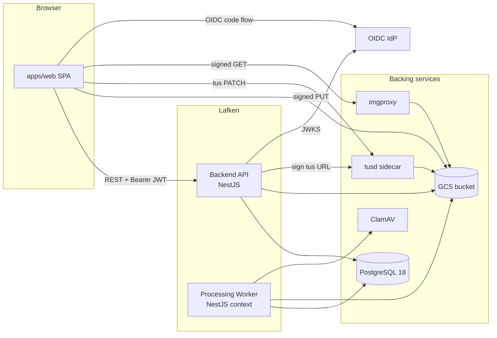

# Architecture

Lafken is an asset-management service for organizations that handle
user-uploaded images at scale. This document describes the runtime
topology, the bounded contexts, and the hexagonal layering rule that
governs how the code is organized.

## Repository layout

Turborepo monorepo with pnpm workspaces.

| Path | Description |
| ---- | ----------- |
| `apps/backend` | NestJS service. Public HTTP API + processing worker. |
| `apps/web` | React 19 SPA built with Vite. CSR only. |
| `packages/client` | `@lafken/client` — typed REST SDK. |
| `packages/upload` | `@lafken/upload` — Uppy-based browser upload manager. |
| `packages/react` | `@lafken/react` — React hooks and components. |
| `shared/backend-api` | Backend DTOs. Single source of truth for public API shapes. |
| `shared/web-tests` | Playwright E2E. |
| `shared/style-config`, `shared/typescript-config` | Shared presets. |

## Bounded contexts

The backend is split into eight bounded contexts plus a `shared` module
that holds cross-cutting infrastructure.

| Context | Purpose |
| ------- | ------- |
| `assets` | Upload intents, processing pipeline, serving URLs, asset state. |
| `audit` | Configuration audit log + asset state-transition log. |
| `dashboard` | Read-only aggregates surfaced to the operator console. |
| `health` | Liveness/readiness probes. |
| `legal-holds` | Place / lift legal holds on assets. |
| `namespaces` | Namespace + versioned policies + versioned presets. |
| `quarantine` | Operator review workflow for quarantined assets. |
| `system` | Storage bindings, integrations, system settings. |

## Hexagonal layering

Each context follows the same four-layer split:

```
domain/         entities, value objects, errors, ports (abstract classes)
application/    use cases, application services
infrastructure/ port implementations (Kysely repos, GCS clients, ...)
presentation/   controllers, response mappers
```

Dependencies point inward only: `presentation → application → domain`
and `infrastructure → domain`. The rule is enforced by
`pnpm dep-check` (Dependency Cruiser).

## Runtime topology



Bytes never traverse the API. Browsers upload directly to GCS (simple
mode) or to `tusd` (resumable mode). Imgproxy fetches the original from
GCS using a per-render signed source URL minted by the API.

## Ports and adapters (v1.0)

Lafken v1.0 ships exactly one adapter per port. Future versions may add
alternatives; the port boundary is the seam.

| Port | Adapter (v1.0) | Lives in |
| ---- | -------------- | -------- |
| `StorageObjectStorePort` | GCS V4-signed URLs + GCS object operations | `apps/backend/src/assets/infrastructure/services/` |
| `VirusScanPort` | ClamAV over TCP (prod) or local stub (dev) | `apps/backend/src/assets/infrastructure/services/` |
| `MimeSniffPort` | `file-type` magic-byte sniff | same |
| `ImageInspectionPort` | `sharp` + `exifr` | same |
| `ContentAnalysisPort` | local stub (policy-driven decision) | same |
| `RendererPort` | imgproxy with per-render signed source URL | same |
| `AuthenticationPort` | OIDC (`jose` for JWKS verification) | `apps/backend/src/shared/presentation/auth/oidc/` |
| `AuthorizationPort` | `allow-all` (role-gated at controller via decorator) | `apps/backend/src/shared/infrastructure/authorization/` |
| `AppLoggerPort` | Pino via `nestjs-pino` | `apps/backend/src/shared/infrastructure/logger/` |
| `UnitOfWorkPort` | Kysely transaction | `apps/backend/src/shared/infrastructure/persistence/` |
| `ClockPort`, `IdGeneratorPort` | system clock / `uuidv7` via Postgres | same |

## Process model

The backend ships as **two processes** that share the same NestJS code
base, the same modules, and the same configuration.

| Process | Entrypoint | Scripts |
| ------- | ---------- | ------- |
| API | `apps/backend/src/main.ts` | `pnpm -F backend dev`, `pnpm -F backend start` |
| Processing worker | `apps/backend/src/processing-worker.ts` | `pnpm -F backend dev:worker`, `pnpm -F backend start:worker` |

Both connect to the same Postgres database. The worker claims rows from
the `processing_jobs` table; the API never reaches into the worker
directly.

## Storage

- **PostgreSQL 18** — primary store. Schemas owned by each bounded
  context. Migrations are dbmate raw SQL (`pnpm -F backend migrate`).
- **GCS bucket** — original bytes (`originals/<namespace>/<sha256>`)
  and quarantined bytes (`quarantine/<namespace>/<sha256>`). Derivatives
  are not pre-generated.

## Test strategy

| Tier | Where | What runs |
| ---- | ----- | --------- |
| Unit | `apps/backend/test/unit/`, colocated mapper tests | Pure domain + use-case tests with in-memory ports. |
| Integration | `apps/backend/test/integration/` | Repository + adapter tests against real Postgres / fake GCS. |
| E2E | `apps/backend/test/e2e/` | Full HTTP flow with supertest. |
| Web | `apps/web` Vitest + RTL | Component tests via MSW node server. |
| Web E2E | `shared/web-tests` (Playwright) | Browser flows against built `apps/web` + a local backend. |

See [`dev-setup.md`](./dev-setup.md) for how to run each tier locally.
