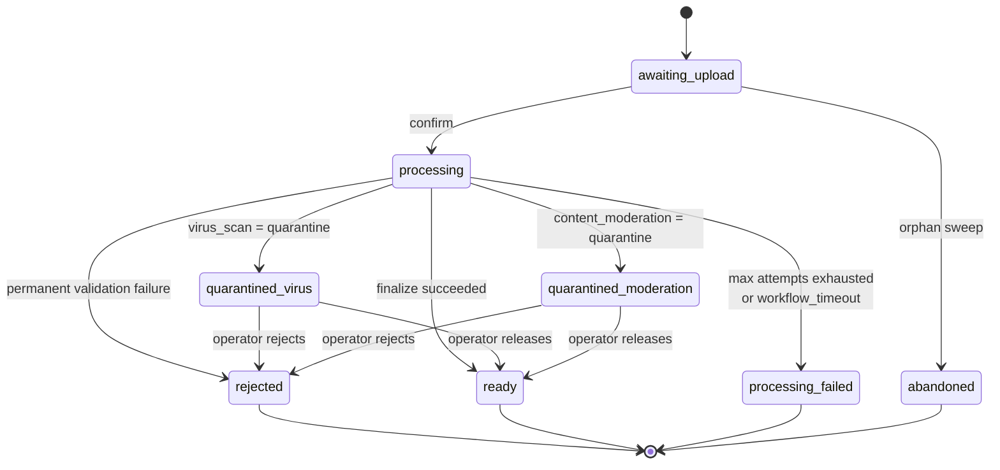
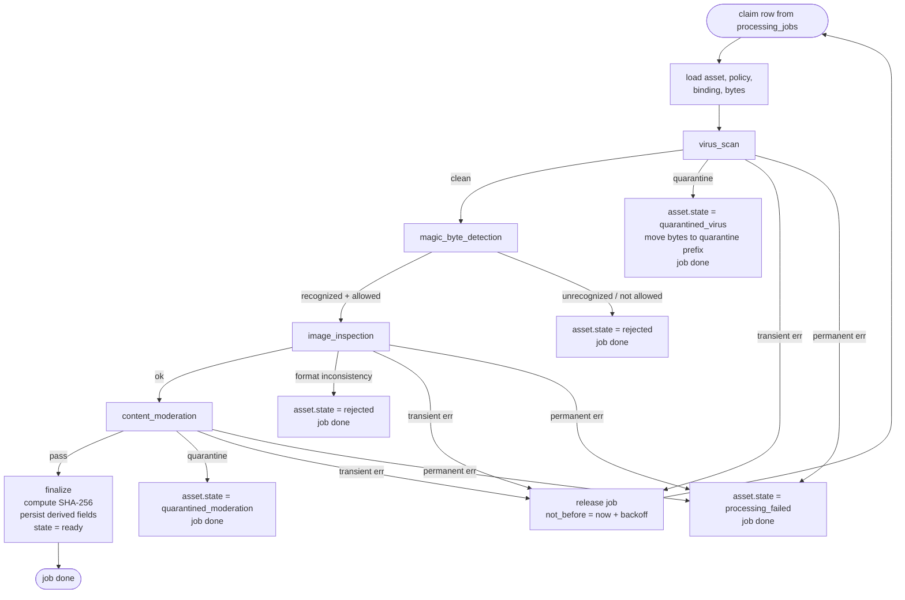

# Processing pipeline

Once an asset is confirmed, the processing worker takes over: it
claims a row from `processing_jobs`, validates the bytes, runs the
namespace's content-moderation policy, and transitions the asset to a
terminal state.

The worker is a separate process that runs the same NestJS code base
as the API. See [`architecture.md`](./architecture.md) for the
process model.

## Asset state machine



Terminal states are: `ready`, `rejected`, `quarantined_virus`,
`quarantined_moderation`, `processing_failed`, `abandoned`.

## Worker step flow

The worker runs five sequential steps after claiming a job and loading
the asset, policy, binding, and bytes.



No event is emitted at finalize — Lafken v1.0 does not publish events.
Downstream apps poll `GET /v1/assets/{publicId}` until the state is
terminal.

## Retry policy

Single-tier exponential backoff with half-jitter. All retries release
the job back to `processing_jobs` with a `not_before` timestamp; there
are no in-memory retries inside a single claim.

```
delay_ms = min(
  initial_backoff * (multiplier ^ (attempt - 1)) * jitter(0.5..1.0),
  max_backoff
)
```

| Knob | Default | Purpose |
| ---- | ------- | ------- |
| `PROCESSING_WORKER_MAX_ATTEMPTS` | 5 | Total attempts before terminal `processing_failed`. |
| `PROCESSING_WORKER_INITIAL_BACKOFF_MS` | 1000 | Base delay after first failure. |
| `PROCESSING_WORKER_BACKOFF_MULTIPLIER` | 3 | Multiplier per attempt. |
| `PROCESSING_WORKER_MAX_BACKOFF_MS` | 600000 | Per-attempt cap (10 minutes). |
| `PROCESSING_WORKER_WORKFLOW_TIMEOUT_MS` | 900000 | Whole-workflow upper bound (15 minutes). |

Only errors flagged as `TransientProcessingError` are retried (network,
5xx, 429, timeouts). Permanent errors transition the asset directly to
its terminal state with no further attempts.

## Whole-workflow timeout

Each claim arms a `setTimeout` for
`PROCESSING_WORKER_WORKFLOW_TIMEOUT_MS` from the moment the row is
claimed. If the timer fires before the workflow reaches a terminal
state, the asset transitions to `processing_failed` with
`state_reason = 'workflow_timeout'` and the job is finalized.

## Stale-claim sweeper

A separate loop on the worker reclaims rows whose worker died without
releasing them.

| Knob | Default | Purpose |
| ---- | ------- | ------- |
| `PROCESSING_WORKER_HEARTBEAT_INTERVAL_MS` | 10000 | How often live workers heartbeat their claims. |
| `PROCESSING_WORKER_STALE_CLAIM_MS` | 60000 | Age past last heartbeat before a claim is considered stale. |

A stale claim is released back to `processing_jobs` and counts toward
`PROCESSING_WORKER_MAX_ATTEMPTS`.

## Configuration

See [`configuration.md`](./configuration.md) for the full env-var
reference, including the orphan-intent sweep loop that lives on the
same worker process.
