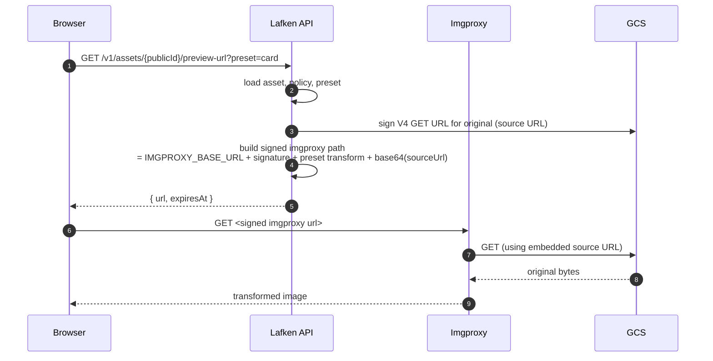
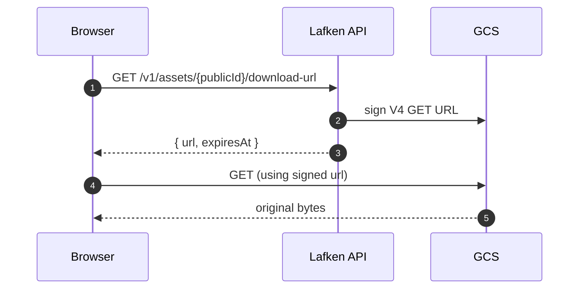

# Serving

Lafken serves assets in **signed mode** for v1.0. Every preview and
download URL is short-lived and individually signed; there are no
public buckets and no permanent CDN paths.

The `serving_mode` column on `namespace_policies` is reserved for
future use. The runtime ignores it and always behaves as if the
namespace were `signed`. The public + proxied serving modes from
spec §7.1 are deferred.

## Preview URL flow (imgproxy)

A *preview* is an on-the-fly transformation of the original (resize,
crop, format conversion) defined by a *preset* attached to the
namespace's active policy version.

Imgproxy never sees a long-lived bucket credential — every render
carries its own GCS source URL signed for that single fetch.

`IMGPROXY_STRIP_METADATA=true` is set at the imgproxy deployment
level, so the served bytes never carry EXIF even though the original
in GCS retains it.

## Download URL flow

A *download* serves the original bytes unchanged. The API mints a V4
signed GCS GET URL and the browser fetches GCS directly.

## EXIF posture

- The original in GCS retains all EXIF metadata.
- Imgproxy strips metadata at serve time
  (`IMGPROXY_STRIP_METADATA=true`).
- The processing pipeline extracts capture-context (GPS, captured-at,
  device) into structured columns at the
  [`image_inspection`](./processing-pipeline.md) step. That structured
  data is what the admin console surfaces.

The `exif_handling` column on `namespace_policies` is retained on the
schema for forward compatibility but is ignored by the runtime; the
operator-console toggle for it has been removed.

## TTL and refresh

Both preview and download URLs carry an `expiresAt` ISO timestamp.
`@lafken/react`'s `<AssetImage>` and `useAssetPresetUrl` hook track
expiry and refresh in the background within
`REFRESH_THRESHOLD_MS` (default 60 000 ms) of expiry — see
[`sdk.md`](./sdk.md).
