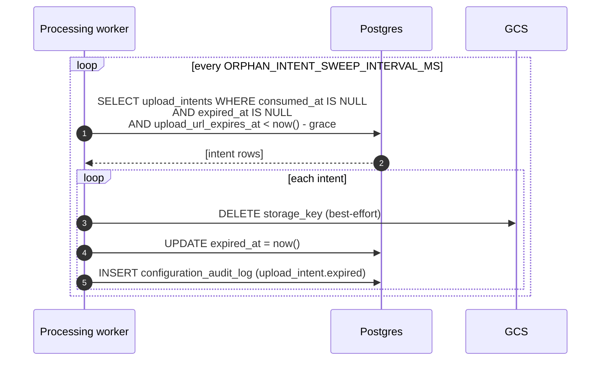

# Upload flow

This page describes how bytes get from a browser into a Lafken-managed
asset, including the resumable (tus) variant, the signed-URL refresh
path, and the orphan-intent sweep that reclaims expired uploads.

The backend never touches the byte stream. Bytes flow
`browser → GCS` (simple mode) or `browser → tusd → GCS` (resumable
mode). The backend issues short-lived signed URLs and records
metadata.

## Stages

| Stage | Endpoint | Effect |
| ----- | -------- | ------ |
| Intent | `POST /v1/assets/upload-intents` | Reserves an asset row + storage key, returns a signed upload URL. |
| Upload | (PUT to GCS, or PATCH to tusd) | Browser sends bytes directly to storage. Backend is not involved. |
| Refresh | `POST /v1/assets/upload-intents/{publicId}/refresh-url` | Issues a fresh signed URL for the same storage key. Used when the original is about to expire. |
| Confirm | `POST /v1/assets/{publicId}/confirm` | Tells the backend the bytes have arrived; enqueues a processing job. |
| Process | (async, processing worker) | Worker claims the job, runs the pipeline, transitions the asset to a terminal state. |

## Simple direct-to-GCS upload

```mermaid
sequenceDiagram
    autonumber
    participant Browser
    participant API as Lafken API
    participant DB as Postgres
    participant GCS

    Browser->>API: POST /v1/assets/upload-intents { protocol: "simple" }
    API->>DB: INSERT upload_intents, asset (state: awaiting_upload)
    API->>GCS: sign V4 PUT URL
    API-->>Browser: { publicId, uploadUrl, uploadHeaders, expiresAt }

    Browser->>GCS: PUT (bytes) using uploadUrl
    GCS-->>Browser: 200 OK

    Browser->>API: POST /v1/assets/{publicId}/confirm
    API->>DB: mark intent consumed; INSERT processing_jobs
    API->>DB: asset state -> processing
    API-->>Browser: 202 Accepted
```

## Resumable (tus) upload

```mermaid
sequenceDiagram
    autonumber
    participant Browser
    participant API as Lafken API
    participant DB as Postgres
    participant Tusd
    participant GCS

    Browser->>API: POST /v1/assets/upload-intents { protocol: "tus" }
    API->>DB: INSERT upload_intents, asset (state: awaiting_upload)
    API->>Tusd: prepare resource (out-of-band; tusd writes to GCS)
    API-->>Browser: { publicId, uploadUrl: "<tusd-url>", protocol: "tus", expiresAt }

    Browser->>Tusd: POST/PATCH (chunks) using uploadUrl
    Tusd->>GCS: stream chunks
    Tusd-->>Browser: 204 No Content (final)

    Browser->>API: POST /v1/assets/{publicId}/confirm
    API->>DB: mark intent consumed; INSERT processing_jobs
    API-->>Browser: 202 Accepted
```

`TUSD_ENDPOINT_URL` must be configured for tus mode. When unset,
`POST /v1/assets/upload-intents { protocol: "tus" }` returns
`422 Unprocessable Entity` with `TusNotConfiguredError`.

## Refresh signed URL

The signed URL the API mints has a short lifetime (minutes, not hours).
A long-running upload — slow connection, paused user, browser tab in
the background — can outlive its URL. The refresh endpoint issues a
new URL for the same storage key without creating a new intent.

```mermaid
sequenceDiagram
    autonumber
    participant Browser
    participant API as Lafken API
    participant DB as Postgres
    participant GCS

    Note over Browser: existing intent, expiresAt approaching
    Browser->>API: POST /v1/assets/upload-intents/{publicId}/refresh-url
    API->>DB: SELECT upload_intent (must be unconsumed, not expired)
    API->>GCS: sign fresh V4 PUT URL (or fresh tus URL)
    API->>DB: UPDATE upload_url_expires_at; INSERT configuration_audit_log (upload_intent.url_refreshed)
    API-->>Browser: { uploadUrl, uploadHeaders, expiresAt }

    Browser->>GCS: PUT (bytes) using new uploadUrl
```

The `@lafken/upload` manager calls this automatically when
`expiresAt - now() < refreshSafetyMarginMs` (default 30 000 ms).

## Orphan-intent sweep

Some intents are never confirmed. The processing worker runs an
`orphan-intent-sweep` loop that claims expired-and-unconsumed intents,
best-effort deletes the bytes, and marks the intent expired.



`tusd`'s own retention TTL reaps any in-flight tus sessions that never
finalize; Lafken's sweep does not poke tusd.

## Failure modes

| Symptom | Cause | Resolution |
| ------- | ----- | ---------- |
| 404 on `confirm` | Intent already swept (long abandoned) | Create a fresh intent. |
| 422 `UploadIntentExpiredError` on `refresh-url` | Intent already swept | Create a fresh intent. |
| 422 `UploadIntentAlreadyConsumedError` on `refresh-url` | Intent already confirmed | No action; asset is processing. |
| 422 `TusNotConfiguredError` on intent creation with `protocol: "tus"` | `TUSD_ENDPOINT_URL` unset | Set `TUSD_ENDPOINT_URL` or use `protocol: "simple"`. |

See also: [`processing-pipeline.md`](./processing-pipeline.md) for what
happens after `confirm`.
